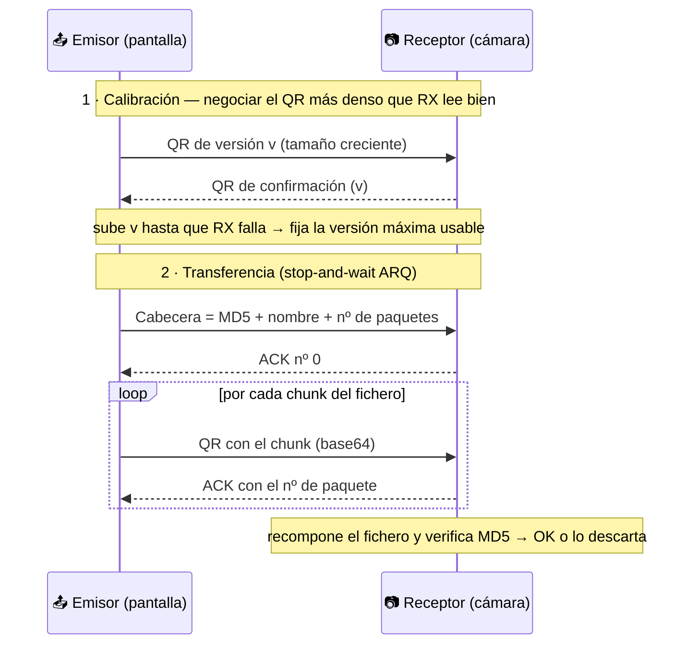

<h1 align="center">📡 FileTransferusingQR</h1>

<p align="center">
  <b>Transfiere ficheros entre dos ordenadores sin red, sin cables y sin Bluetooth — solo una pantalla y una cámara.</b>
</p>

<p align="center">
  
  
  
  
  
</p>

> **Trabajo Fin de Grado (Ingeniería Telemática).** Un canal de datos **puramente óptico**: el emisor "pinta" el fichero en una secuencia de códigos QR en su pantalla y el receptor los lee con la webcam, **confirmando cada paquete** con otro QR de vuelta. Sin pila de red de por medio: una especie de *data diode* visual hecho en casa.

---

## 🧠 La idea

¿Y si dos equipos pudieran intercambiar un fichero **sin compartir absolutamente ningún medio digital** — ni WiFi, ni cable, ni USB, ni Bluetooth? La única conexión es la **luz**: una pantalla mostrando QRs y una cámara leyéndolos.

Eso obliga a resolver, a pequeña escala, los mismos problemas de cualquier protocolo de comunicaciones real:

- **Negociar la velocidad del canal** según su calidad (aquí: cuánta densidad de QR aguanta la cámara).
- **Fragmentar** el fichero en paquetes y **numerarlos**.
- **Confirmar** la recepción de cada paquete (control de flujo).
- **Verificar la integridad** del resultado.

## ⚙️ Cómo funciona



**1. Calibración.** El emisor muestra QRs de densidad creciente (`version` de la librería `qrcode`) y el receptor confirma los que logra leer. Cuando la cámara ya no puede, se fija la **versión máxima** usable. Así el canal se adapta a cada pantalla/cámara en lugar de asumir una calidad fija.

**2. Transferencia (stop-and-wait ARQ).** El emisor manda primero una **cabecera** (`hash MD5 + longitud del nombre + nombre + número de paquetes`) y después los chunks del fichero codificados en **base64**. Cada QR solo avanza cuando el receptor devuelve el **ACK** con el número de paquete esperado — control de flujo clásico sobre un medio nada fiable.

**3. Integridad.** Al terminar, el receptor calcula el **MD5** del fichero reconstruido y lo compara con el de la cabecera. Si no coincide, **descarta** el archivo corrupto.

## ✨ Características

- 🔌 **Cero red:** transferencia 100% offline / air-gapped (solo pantalla ↔ cámara).
- 📶 **Canal adaptativo:** calibra la densidad de QR a la calidad real del enlace.
- ✅ **Fiabilidad:** confirmación paquete a paquete (ARQ) + verificación MD5.
- 🖥️ **GUI simple** en Tkinter: calibrar/enviar/recibir con botones.
- 📊 **Métricas:** registra tiempo de transmisión y **tasa (Bytes/s)** en un fichero de estadísticas.

## 🛠️ Stack

`Python` · `OpenCV (cv2)` para la captura de vídeo · `pyzbar` para decodificar QR · `qrcode` para generarlos · `Tkinter` para la interfaz · `hashlib` (MD5) · `base64`.

## 📦 Instalación

```bash
pip install opencv-python pyzbar qrcode
```
> En Windows, `pyzbar` necesita el *Visual C++ Redistributable* (normalmente ya instalado). El resto de dependencias (`tkinter`, `hashlib`, `base64`, `math`, `os`, `time`) vienen con Python.

## ▶️ Uso

Necesitas **dos equipos**, cada uno con **pantalla y webcam**, enfrentados de modo que cada cámara vea la pantalla del otro.

```bash
python Aplicacion.py
```

En la ventana:
1. En el receptor pulsa **RX: Calibrar** y en el emisor **TX: Calibrar** (deja que negocien la densidad).
2. Luego **RX: Recibir Archivo** y **TX: Enviar Archivo**, y selecciona el fichero a enviar.

> ℹ️ El nombre del fichero debe tener **menos de 10 caracteres** (extensión incluida), porque va embebido en la cabecera de tamaño fijo.

## ⚠️ Limitaciones conocidas (es un PoC de TFG)

- La calibración depende de la **pantalla y cámara concretas**; la tabla de tamaños está ajustada al equipo del autor.
- Nombre de fichero `< 10` caracteres.
- Un solo fichero por envío; sin reintento selectivo (si un paquete se pierde de forma persistente, se aborta).

## 🚀 Mejoras futuras (ideas)

- Cabecera de **nombre de longitud variable** (quitar el límite de 10 caracteres).
- **Corrección de errores** por encima del nivel `L` y reintentos selectivos.
- Sustituir MD5 por **SHA-256** para la verificación de integridad.
- Empaquetar dependencias en un `requirements.txt` y añadir un **GIF de demostración**.

## 🔐 Por qué me sigue interesando

Un canal óptico unidireccional como este es también una técnica conocida de **transferencia a través de air-gaps**: mover datos entre una red aislada y el exterior sin ningún medio de red. Entender cómo se construye (y cómo se detectaría) conecta directamente con mi trabajo en seguridad ofensiva y defensiva.

## 📄 Licencia

Proyecto académico (TFG). Uso educativo.

---

<sub>Autor: <b>Datefer</b> · Trabajo Fin de Grado, Ingeniería Telemática.</sub>
